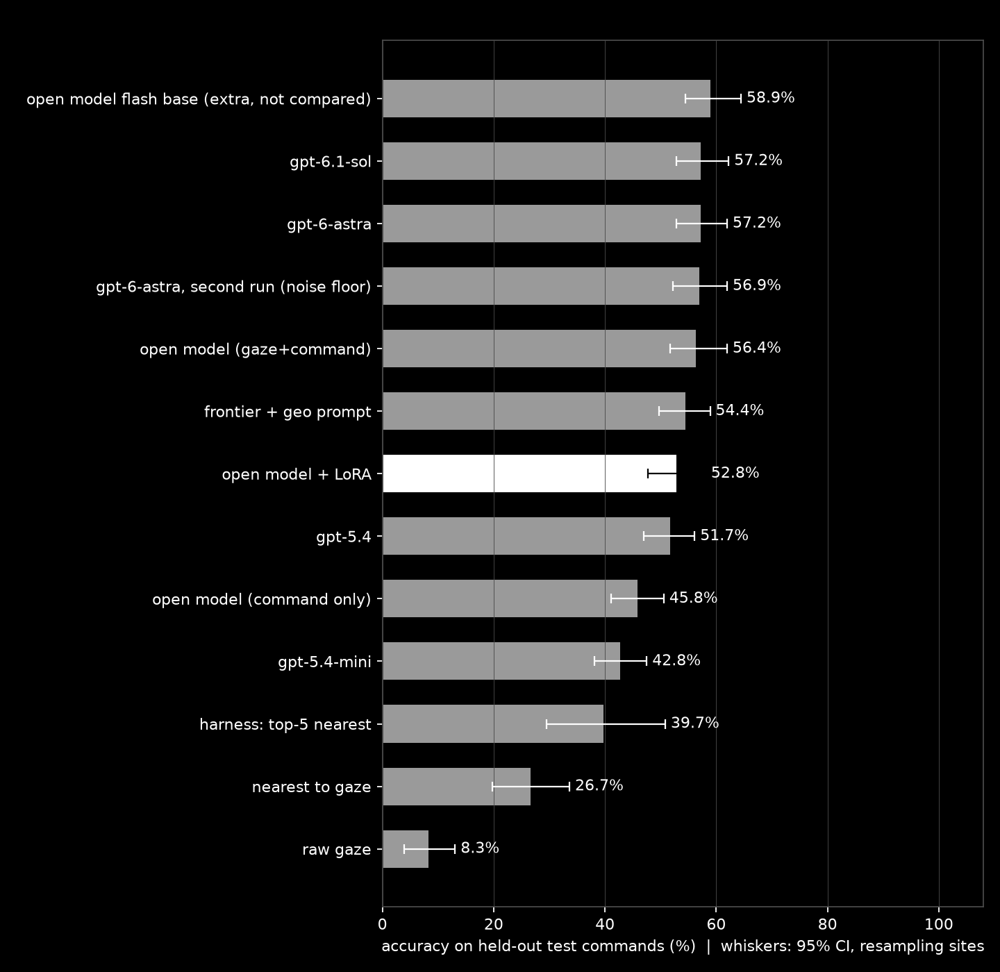
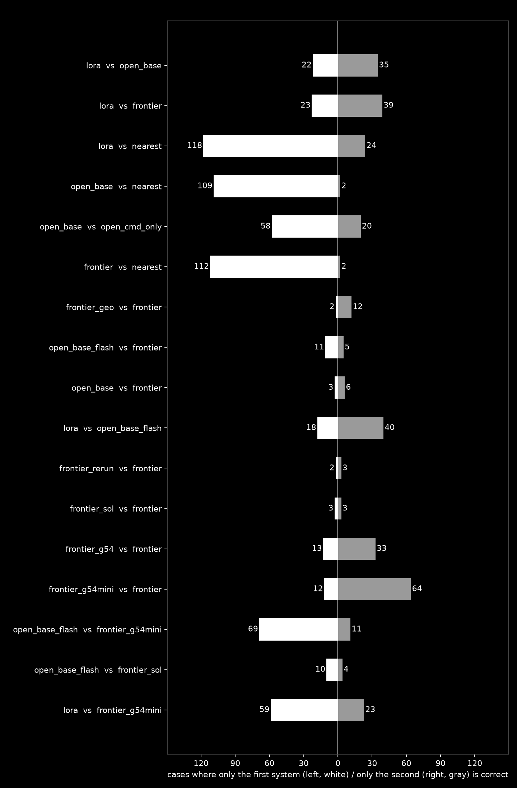
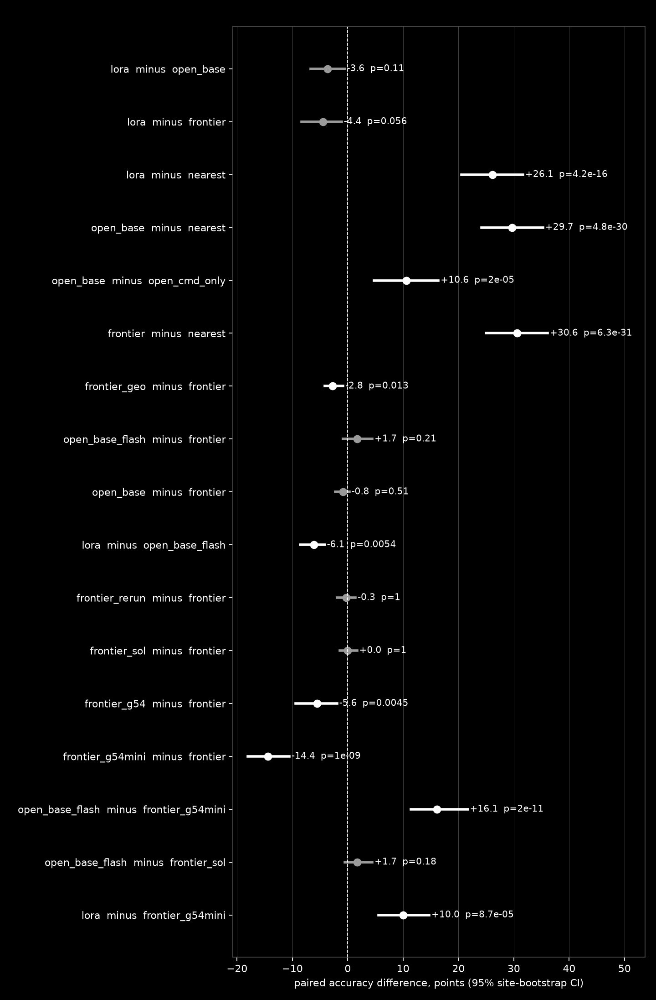

# Glance

**Operate your agent with your eyes.**

Your eyes are the cursor. Your voice is the command.
Say "open that" and your agent knows which "that."

Glance is a macOS app. The webcam tracks where you look and moves the real cursor; a wink clicks, a nod scrolls.
When you add a short spoken command, an agent running a model on Fireworks picks the exact on-screen element you mean
from where you were looking and what you said, and acts on it, even when the eye tracker is off by 100 to 200 px.

Agents can hear you. Glance lets you point.

### The agent

| | What it does | State |
|---|---|---|
| One step per command | Reads your gaze, your command and the page's elements, picks one, shows a ring on it, clicks | Built; the benchmark measures this step |
| Multi-step tasks | "Schedule it": observe, decide, act, check, repeat until done, confirming before any send or save | In progress; not part of the benchmark |

Built at the Fireworks: Deploy Buildathon (Microsoft & NVIDIA), San Francisco, 2026-11-02.

## Results at a glance

360 held-out commands from 8 sites the models never saw, 13 systems, the same cases and the same prompt for all (details and limits below).

- **Eyes add real information.** Gaze + voice beats voice alone: **56.4% vs 45.8%, +10.6 points** (McNemar p = 2e-5). Raw gaze alone gets 8.3%, the nearest element to the gaze 26.7%.
- **An open model with no training matches the frontier.** Fireworks `glm-5p3-flash` 58.9% vs OpenAI `gpt-6-astra` 57.2% (no reliable difference), at **$0.65 vs $12.20 per 1,000 commands**. The cheapest OpenAI model that matches it (`gpt-6.1-sol`, 57.2%) costs $2.47, so about 3.8 times cheaper there.
- **It beats the small closed model at a lower price.** `glm-5p3-flash` vs `gpt-5.4-mini`: **+16.1 points** (58.9% vs 42.8%, p < 0.0001), $0.65 vs $0.88.
- **The benchmark is hard to fool.** Test set locked by SHA-256 and split by site, McNemar plus a site-level bootstrap (a gain counts only if both agree), a non-model baseline, a noise-floor rerun of the frontier model (56.9% vs 57.2%), and every failure reported.
- **Where the model does not help yet.** For "open that" commands (deictic, 95 test cases) every model scores 18 to 26%, no better than the nearest element (24.2%): the gaze alone decides there. The model's strength is when the command carries language (82 to 95% on partial names). See "By command type".
- **What did not work, reported anyway.** Our LoRA did not beat its base (52.8% vs 56.4%, -3.6, not called real; it did cut format errors from 26 to 0). A top-5 filter scored 39.7%. A distance prompt hurt the frontier model (-2.8, p = 0.013). The open reasoning models are slower (4.4 s vs 1.6 s): no latency win.

## Why it works

Webcam eye tracking is good enough to point near something, not at it. Voice alone is ambiguous: a page has dozens of "that"s.
Neither signal is enough alone. Together they are.

| Signal | What it gives | What it lacks |
|---|---|---|
| Gaze | Where on screen | Precision (100 to 200 px off), so it lands between elements |
| Voice | What to do | Which element ("open that") |
| **Gaze + voice + the screen's elements, in one model call** | The element | |

Gaze never clicks by itself. A click always needs a wink, a spoken command or a deliberate action on the wheel, so looking around is safe. Only the normal macOS cursor follows your eyes; Glance draws a circle only while the wheel is open.

## How it works

```
LAPTOP (local, private)
  Webcam -> MediaPipe Face Landmarker (iris, blendshapes, head pose)
         -> personal 9-point calibration (ridge fit, seconds)
         -> smoothed cursor + gestures (wink, nod, mouth) -> native mouse helper (Rust)
  Mic    -> speech to text (push to talk, Option+Space)
  Page   -> element extractor (id, role, name, box)

FIREWORKS (the brain)
  gaze point + command + elements (text) -> open model -> {"target": <element id>}

LAPTOP
  ring + name tag on the chosen element -> click
```

The eyes run locally on purpose: the cursor needs a frame every ~33 ms, a cloud call takes hundreds of ms,
and sending face video off the machine is a privacy problem. Only text (a gaze point, a command and element names)
goes to the model. No images leave the laptop.

The app and the benchmark share one prompt (`packages/contracts/prompts/intent.txt`) and one element format
(`packages/elements/extract.js`), pinned by a golden fixture that Python and TypeScript must both reproduce byte for byte.
What we measure is what the app runs.

## Controls

| Action | Gesture |
|---|---|
| Move | Look (smoothed gaze moves the real cursor) |
| Left click / right click | Wink left / wink right |
| Double click | Double wink |
| Drag | Open mouth = press, move your gaze, close mouth = drop |
| Scroll | Raise brows, nod up or down |
| Action wheel (radial menu) | Close BOTH eyes for about 1 s (0.7 s minimum; a blink or a wink does not count). It opens where you were looking. Look at an item for 1 s to choose it; close your eyes again, press Esc, or look away for 2 s to dismiss. The old 1 s stare is an opt-in toggle on the dashboard |
| Voice command | Option+Space, speak, Option+Space |
| Pause tracking | Alt+Shift+P |

Onboarding runs a 9-point calibration, reports its leave-one-out error in px, and tests which gestures work for your face.
Calibration stays in Electron's user-data directory, never in the repo. Full desktop guide: `apps/desktop/README.md`.

## The benchmark

**Task:** a noisy gaze point + a short command + the clickable elements on screen -> the one element the user means (`{"target": <element id>}`).
Neither signal is enough alone: gaze lands 100 to 200 px off, and "open that" fits many elements.

### Data (all reproducible from `data/sites/*.json` and seed 20261102; details in `data/README.md`)

| | Sites | Pages | Cases |
|---|---|---|---|
| Train | 28 | 41 | 2,520 |
| **Test (locked)** | **8** | 15 | **360** |

- **Source:** Playwright crawl of 36 public sites (50+ tried; bot walls and empty shells dropped). Each case stores every clickable element with id, role, accessible name and box (max 80 per page).
- **Split by site, never by case.** No site is in both splits. The test set is locked: `data/dataset/manifest.json` has `locked: true` and `test_sha256` (`5233ce37...`), and the runner refuses to score if the file does not match.
- **Test sites:** craigslist.org, github.com, huggingface.co, linear.app, lobste.rs, npr.org, openstreetmap.org, w3schools.com (45 cases each).
- **Gaze is simulated:** the element center plus Gaussian noise, sigma 60, 120 or 180 px (a third of the cases each). Measured mean error on the test set: 66.7, 131.8 and 190.2 px. Published webcam error is about 100 to 200 px (WebGazer, WebEyeTrack), so sigma 60 is optimistic and 120 and 180 are realistic. Cases are resampled so the answer is within 2.5 sigma of the gaze point.
- **Commands are templates, not written by any model we compare:** `deictic` ("open that", 95 test cases), `role` ("the button", 96), `partial_name` ("the pricing one", 103) and `ordinal` ("the second link", 66).

### Systems (13, same test cases, same prompt, same scoring)

The prompt is `packages/contracts/prompts/intent.txt`, pinned by a golden fixture that Python and TypeScript both reproduce byte for byte. One user message, no system message.

| Provider | Systems |
|---|---|
| No model | `raw_gaze`, `nearest` |
| **Fireworks** (open models) | `open_cmd_only`, `open_base`, `harness_top5` on `glm-5p3`; `open_base_flash` on `glm-5p3-flash`; **`lora`**: `glm-5p3` + a LoRA we trained with Fireworks serverless training |
| OpenAI (closed models) | `frontier` and `frontier_rerun` and `frontier_geo` on `gpt-6-astra`; `frontier_sol` (`gpt-6.1-sol`); `frontier_g54` (`gpt-5.4`); `frontier_g54mini` (`gpt-5.4-mini`) |

Run settings: open models at temperature 0 and 8,192 max tokens (GLM-5.3 models are thinking-only, so the reasoning trace is billed and counted in cost; a reply cut off at the limit has no answer and is scored wrong). OpenAI models: the API rejects any temperature but the default, so they run at the default, which is why we reran `gpt-6-astra` to measure run-to-run noise. Transient errors (429, connection, 5xx) are retried and never scored wrong. Per-model prices and settings: `results/PRICING.md`.

### Statistics

- **McNemar** (exact, two-sided) on the cases where two systems disagree.
- **Cluster bootstrap** that resamples whole sites, 5,000 draws, 95% percentile interval on the paired accuracy difference.
- **A gain counts as real only when both agree** (p < 0.05 and the interval excludes zero). If they disagree we say so and do not call it real.
- Only 8 test sites, so intervals are wide.

## Results

360 held-out commands from 8 sites never used in training. Everything below is generated from `results/summary.json`, which is generated from `results/rows/*.jsonl` (one row per case per system, with the raw model reply). Cost = measured tokens times list price, no cached-input discount, so costs are upper bounds.

### Leaderboard

| # | System | What | Top-1 | 95% CI (sites) | $ / 1,000 | p50 | p95 | No answer |
|---|---|---|---|---|---|---|---|---|
| 1 | `open_base_flash` | glm-5p3-flash, untrained, gaze + command | **58.9%** | 54.4 to 64.4 | $0.65 | 2.8 s | 34.9 s | 12 |
| 2 | `frontier` | gpt-6-astra, gaze + command (frontier baseline) | **57.2%** | 52.8 to 61.9 | $12.20 | 1.6 s | 3.8 s | 0 |
| 3 | `frontier_sol` | gpt-6.1-sol, gaze + command | **57.2%** | 52.8 to 62.2 | $2.47 | 1.4 s | 3.8 s | 0 |
| 4 | `frontier_rerun` | gpt-6-astra, second run (noise floor) | **56.9%** | 52.2 to 62.0 | $12.27 | 1.6 s | 4.2 s | 0 |
| 5 | `open_base` | glm-5p3, gaze + command | **56.4%** | 51.7 to 61.9 | $7.76 | 4.4 s | 75.0 s | 26 |
| 6 | `frontier_geo` | gpt-6-astra, prompt with each element's distance to the gaze | **54.4%** | 49.7 to 58.9 | $13.79 | 1.5 s | 3.9 s | 0 |
| 7 | `lora` | glm-5p3 + our LoRA (Fireworks serverless training) | **52.8%** | 47.8 to 58.1 | $5.79 (est.) | 1.6 s * | 2.2 s * | 0 |
| 8 | `frontier_g54` | gpt-5.4, gaze + command | **51.7%** | 46.9 to 56.1 | $2.88 | 0.7 s | 1.2 s | 0 |
| 9 | `open_cmd_only` | glm-5p3, command only (no gaze) | **45.8%** | 41.1 to 50.6 | $5.62 | 3.0 s | 56.7 s | 9 |
| 10 | `frontier_g54mini` | gpt-5.4-mini, gaze + command | **42.8%** | 38.1 to 47.5 | $0.88 | 0.6 s | 0.9 s | 0 |
| 11 | `harness_top5` | glm-5p3, only the 5 elements nearest the gaze | **39.7%** | 29.4 to 50.8 | $6.28 | 4.6 s | 80.8 s | 27 |
| 12 | `nearest` | Element whose box is nearest to the gaze point | **26.7%** | 19.7 to 33.6 | $0 | local | local | 0 |
| 13 | `raw_gaze` | Element under the gaze point (none = wrong) | **8.3%** | 3.9 to 13.1 | $0 | local | local | 229 |

`*` The LoRA's cost and latency come from a training session and are **estimates**, not serving numbers (a tuned LoRA needs an hourly-billed deployment to serve; we did not create one). "No answer" = no parseable element id (for the open reasoning models, mostly replies cut off at the 8,192-token limit; those count as wrong).



### Is the difference real?

| Comparison (A vs B) | A | B | A - B (pts) | 95% CI (sites) | A only / B only right | McNemar p | Verdict |
|---|---|---|---|---|---|---|---|
| Gaze + command vs command only (open model, glm-5p3) | 56.4% | 45.8% | +10.6 | +4.7 to +16.4 | 58 / 20 | 2e-5 | REAL (both tests agree): open base better |
| Open model vs nearest element | 56.4% | 26.7% | +29.7 | +24.2 to +35.3 | 109 / 2 | 5e-30 | REAL (both tests agree): open base better |
| Frontier vs nearest element | 57.2% | 26.7% | +30.6 | +25.0 to +36.1 | 112 / 2 | 6e-31 | REAL (both tests agree): frontier better |
| LoRA vs nearest element | 52.8% | 26.7% | +26.1 | +20.6 to +31.7 | 118 / 24 | 4e-16 | REAL (both tests agree): lora better |
| LoRA vs its own base (glm-5p3) | 52.8% | 56.4% | -3.6 | -6.7 to -0.6 | 22 / 35 | 0.11 | tests disagree: not called real |
| LoRA vs untrained flash | 52.8% | 58.9% | -6.1 | -8.6 to -4.2 | 18 / 40 | 0.005 | REAL (both tests agree): open base flash better |
| LoRA vs frontier (gpt-6-astra) | 52.8% | 57.2% | -4.4 | -8.3 to -1.1 | 23 / 39 | 0.056 | tests disagree: not called real |
| LoRA vs gpt-5.4-mini | 52.8% | 42.8% | +10.0 | +5.6 to +14.7 | 59 / 23 | 9e-5 | REAL (both tests agree): lora better |
| Open model (glm-5p3) vs frontier | 56.4% | 57.2% | -0.8 | -2.2 to +0.3 | 3 / 6 | 0.51 | no reliable difference |
| Untrained flash vs frontier (gpt-6-astra) | 58.9% | 57.2% | +1.7 | -0.8 to +4.4 | 11 / 5 | 0.21 | no reliable difference |
| Untrained flash vs gpt-6.1-sol | 58.9% | 57.2% | +1.7 | -0.6 to +4.4 | 10 / 4 | 0.18 | no reliable difference |
| Untrained flash vs gpt-5.4-mini | 58.9% | 42.8% | +16.1 | +11.4 to +21.7 | 69 / 11 | 2e-11 | REAL (both tests agree): open base flash better |
| Frontier with distance prompt vs plain prompt | 54.4% | 57.2% | -2.8 | -4.2 to -0.8 | 2 / 12 | 0.013 | REAL (both tests agree): frontier better |
| Frontier run 2 vs run 1 (noise floor) | 56.9% | 57.2% | -0.3 | -1.9 to +1.4 | 2 / 3 | 1.00 | no reliable difference |
| gpt-6.1-sol vs gpt-6-astra | 57.2% | 57.2% | +0.0 | -1.4 to +1.7 | 3 / 3 | 1.00 | no reliable difference |
| gpt-5.4 vs gpt-6-astra | 51.7% | 57.2% | -5.6 | -9.4 to -1.9 | 13 / 33 | 0.005 | REAL (both tests agree): frontier better |
| gpt-5.4-mini vs gpt-6-astra | 42.8% | 57.2% | -14.4 | -18.1 to -10.6 | 12 / 64 | 1e-9 | REAL (both tests agree): frontier better |




What the table says, in plain words:

1. **Eyes add real information.** Gaze + command beats command alone by 10.6 points (both tests agree).
2. **Both beat geometry by a wide margin** (+26 to +31 points over the nearest element).
3. **An untrained open model matches the frontier.** `glm-5p3-flash` (58.9%) and `glm-5p3` (56.4%) are statistically tied with `gpt-6-astra` (57.2%). The cheapest OpenAI model that matches (`gpt-6.1-sol`, 57.2%) costs $2.47 per 1,000 commands, so flash is about 3.8 times cheaper than that and about 19 times cheaper than `gpt-6-astra`.
4. **The open model beats the small closed model at a lower price:** flash vs `gpt-5.4-mini`, +16.1 points, $0.65 vs $0.88.
5. **Our LoRA did not improve on its base.** 52.8% vs 56.4%: the tests disagree, so we do not call it a loss or a win. It is significantly below untrained flash (-6.1, both tests agree). It did remove format errors.
6. **The frontier baseline is stable:** a second run scored 56.9% vs 57.2% (5 cases differ of 360).
7. **Ideas that hurt:** a distance-to-gaze prompt lowered the frontier model by 2.8 points (real); keeping only the 5 nearest elements dropped the open model to 39.7%.

### By gaze error

| System | 60 (n=122) | 120 (n=124) | 180 (n=114) |
|---|---|---|---|
| `raw_gaze` | 11.5% | 8.1% | 5.3% |
| `nearest` | 34.4% | 27.4% | 17.5% |
| `open_cmd_only` | 42.6% | 46.0% | 49.1% |
| `open_base` | 59.0% | 60.5% | 49.1% |
| `open_base_flash` | 62.3% | 62.9% | 50.9% |
| `frontier` | 59.8% | 61.3% | 50.0% |
| `frontier_sol` | 59.8% | 61.3% | 50.0% |
| `frontier_g54mini` | 45.1% | 43.5% | 39.5% |
| `lora` | 54.1% | 53.2% | 50.9% |

From sigma 60 to 180 the models lose about 10 to 11 points (the LoRA only 3; flash 62.3% to 50.9%), while the nearest element loses 17 (34.4% to 17.5%). So the models hold up better than geometry as the gaze gets worse, but none is robust: at 180 px every good system is at about 50%.

### By command type

| System | deictic (n=95) | role (n=96) | partial_name (n=103) | ordinal (n=66) |
|---|---|---|---|---|
| `raw_gaze` | 8.4% | 10.4% | 7.8% | 6.1% |
| `nearest` | 24.2% | 25.0% | 28.2% | 30.3% |
| `open_cmd_only` | 1.1% | 6.2% | 89.3% | 100.0% |
| `open_base` | 23.2% | 33.3% | 94.2% | 78.8% |
| `open_base_flash` | 24.2% | 34.4% | 92.2% | 92.4% |
| `frontier` | 26.3% | 33.3% | 93.2% | 80.3% |
| `frontier_sol` | 24.2% | 34.4% | 92.2% | 83.3% |
| `frontier_g54mini` | 17.9% | 21.9% | 81.5% | 48.5% |
| `lora` | 17.9% | 29.2% | 95.2% | 71.2% |

This table is where the benchmark is most honest about the product, so read it carefully:

- **"Open that" (deictic): no model beats the nearest element.** The command carries no information about which element, so only the gaze can decide. All models land at 18 to 26% against 24.2% for the nearest element. The differences are within a few cases of 95 and we did not test this subset on its own. What the model adds here over command-only (1.1%) is exactly what geometry adds. **Our headline use case does not yet show a model advantage over a simple rule.**
- **Where language decides, the models are strong:** `partial_name` 82 to 95% for every gaze + command system, and `ordinal` 71 to 92% for all but `gpt-5.4-mini` (48.5%).
- **Gaze can hurt when the command is already precise:** on `ordinal`, command-only scores 100% and adding the gaze point lowers `glm-5p3` to 78.8%, the frontier model to 80.3% and flash to 92.4%. The gaze point is a distractor when the command already identifies the element. A system that uses gaze only to break ties would likely do better; we did not build or measure it.
- **`role` is the hardest mixed case** (33 to 34% for the best systems).
- **Context for the ceiling:** the generator's oracle that takes the nearest element among those the command fits (using ground-truth knowledge of which fit) scores 64.8%, 62.9% and 55.3% at sigma 60, 120 and 180 (`data/README.md`), about 61% overall. The best systems at 56 to 59% are within a few points of that rule-based oracle, so with this simulated noise there is limited headroom.
- Why the +10.6 from gaze is real but smaller than it sounds: it comes mostly from `deictic` and `role` commands, where command-only is near zero.

### The LoRA, in detail

We trained one LoRA with Fireworks serverless training and report it as measured, win or not.

| | |
|---|---|
| Base | `accounts/fireworks/models/glm-5p3` (we first targeted `glm-5p3-flash`; Fireworks returned `capacity_exhausted` (HTTP 409) at the real-run start, so we switched to `glm-5p3` and reran the open baselines on it so the comparison is against the LoRA's own base) |
| Data | 2,520 train cases from 28 sites, 1.89M tokens, none from the test sites |
| Hyperparameters | rank 16, alpha 32, learning rate 1e-4 constant, batch 16, 1 epoch, 158 steps, grad clip 1.0 |
| Time | 1,429 s of training (about 9 s per step), scoring 360 cases in 74 s |
| Cost (estimate from the price table, not a bill) | about $27.6 training + $2.1 scoring |
| Target format | the model learned to answer with `{"target": N}` directly, without a reasoning trace; the untrained base reasons first |
| Result | 52.8% (190 of 360) vs 56.4% for its base; 0 unparseable replies vs 26 |

Things that may explain the result and that we did not resolve:
- **A training-loss spike.** The loss per response token was about 0.15 to 0.2 for most of the run, then jumped to 1.86 at step 121 and 2.35 at step 124, stayed near 0.4 to 0.5 until about step 137 and recovered to about 0.14 by the end. We did not investigate (constant learning rate with no warmup is a suspect). We scored only the final checkpoint; scoring intermediate checkpoints on the test set would have been test-set selection.
- **One run, one seed,** and no hyperparameter search.
- **The base was already strong,** so the main thing the LoRA fixed was format, not the choice of element.

Prepared but not run (see below): a second LoRA with the distance prompt and a lower learning rate, and a LoRA on Muse Glimmer 30B (dry-run complete, launch command in `results/train/NOTES.md`).

### What did not finish, and why

Our Fireworks account reached its monthly spending cap at about 13:48 PT and was suspended (HTTP 412 on every call). Everything measured before that is complete and saved. Not run, and listed as `not_run` in `summary.json`:
- `harness_vote` (5 samples at temperature 0.7): 46 of 360 rows were lost, so it is excluded rather than reported on a partial set.
- `open_base_geo` (the open model with the distance prompt) and a second LoRA that depended on it: our validation run was void because every call returned 412, so the experiment was never launched.
- A LoRA on Muse Glimmer 30B.

The **demo app uses OpenAI `gpt-6-astra`** for the model call (`GLANCE_PROVIDER=openai`) because of the suspension; with that variable unset it uses `glm-5p3` on Fireworks. The app never serves our LoRA.

### Reproduce

Every number above can be re-derived **without any API call**, because the rows are saved:

```bash
cd packages/lab
uv run python -m glance_lab.systems.verify     # one row per case per system, ids and answers match the locked test set
uv run python -m glance_lab.stats.report       # McNemar + bootstrap, charts and results/summary.json, from results/rows/*.jsonl
```

To rerun the models you need `FIREWORKS_API_KEY` and `OPENAI_API_KEY` in `.env`. Approximate cost for 360 cases: `gpt-6-astra` $4.4, `gpt-6.1-sol` $0.9, `gpt-5.4` $1.0, `gpt-5.4-mini` $0.3, `glm-5p3` about $2.8, `glm-5p3-flash` $0.2, LoRA training about $28. Raw logs, run settings and the full incident record are in `results/` (`PRICING.md`, `systems-status.md`, `logs/`, `train/NOTES.md`).

## Limits

- **The benchmark gaze is simulated** (target plus Gaussian noise), not recorded from real eyes. It tests the model's choice, not the eye tracker.
- **Eye tracking and gestures are verified with synthetic camera frames.** Wink, brow and mouth thresholds and the head-pose sign need real faces and real lighting.
- **The app never serves our LoRA, and the demo model is OpenAI `gpt-6-astra`** (Fireworks account suspended at its spending cap; the app now defaults to OpenAI, and `GLANCE_PROVIDER=fireworks` selects `glm-5p3` on Fireworks). Serving a LoRA needs an hourly-billed dedicated deployment. LoRA latency is measured inside the training session, which is not serving latency, and is labeled as such.
- **One LoRA per person is the roadmap, not a result.** We have no honest per-user data from today.
- Calibrates and drives the primary display only.
- Dense or canvas-based pages expose few clickable elements, so there is less for the model to choose from.

## Setup

Requires macOS, Node 22+, pnpm, Rust (`cargo`) and `uv`.

```bash
pnpm install
(cd packages/lab && uv sync && uv run playwright install chromium)
cp .env.example .env     # then fill in FIREWORKS_API_KEY and OPENAI_API_KEY
```

macOS permissions: Camera, Accessibility and Microphone (details in `apps/desktop/README.md`).

## Run

```bash
pnpm desktop                            # the app
GLANCE_FAKE_GAZE=mouse pnpm desktop     # the mouse stands in for the eyes (no camera)
pnpm web                                # landing + /try (in-browser demo) + results (copies results/summary.json first)
pnpm test                               # all test suites
```

Benchmark, in order (each step is a script in `packages/lab/package.json`):

```bash
pnpm lab crawl && pnpm lab dataset      # public sites -> locked train/test split
pnpm lab run-systems                    # all non-trained systems on the test set
pnpm lab train                          # LoRA on Fireworks serverless training, scores the test set
pnpm lab stats                          # McNemar + cluster bootstrap, charts, results/summary.json
```

## Monorepo

Turborepo + pnpm. A package can be written in any language; Turbo sees it through the scripts in its `package.json`.

| Path | Language | What |
|---|---|---|
| `apps/desktop` | TypeScript (Electron, React, Tailwind v4, shadcn) | The product |
| `apps/web` | TypeScript (Next.js 16, static export) | Landing, `/try` (in-browser demo: webcam gaze with the same `@glance/gaze` code, a 9-point calibration, a "fine-tune my gaze" refit of your personal mapping, and an explorer of 24 real benchmark cases; runs locally, nothing uploaded; camera path verified with synthetic frames and a fake camera only), `/results` (built from `results/summary.json`, never hand-typed numbers) and `/disclosure`. Not deployed |
| `packages/gaze` | TypeScript | Iris and face features, calibration, smoothing, gestures |
| `packages/brain` | TypeScript | Calls the model on Fireworks to pick the element |
| `packages/contracts` | JSON Schema + TypeScript | Schemas, the shared intent prompt, golden fixture |
| `packages/elements` | JavaScript | `extract.js`: element extractor, shared by the crawl and the app |
| `packages/ui` | TypeScript (shadcn) | Liquid-glass black-and-white design system |
| `packages/input` | Rust | Native mouse helper (move, click, scroll, drag) |
| `packages/lab` | Python (uv) | Benchmark and training: crawl, dataset, systems, stats, LoRA |
| `data/`, `results/` | JSON | Dataset, saved rows per case per system, summary, charts |

See `ARCHITECTURE.md` for ownership and rules.